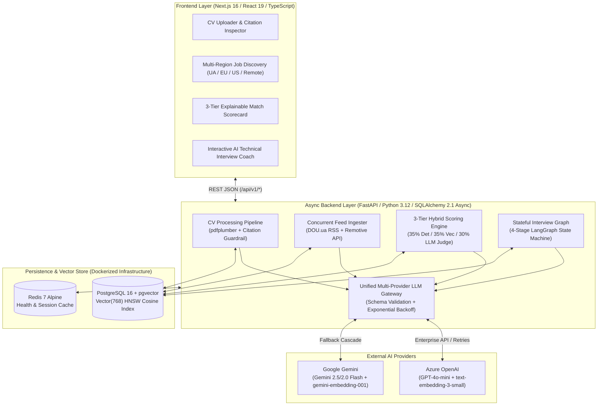

# JobPilot — Production-Grade AI Career Copilot & Technical Interview Engine

[](https://www.python.org/)
[](https://fastapi.tiangolo.com/)
[](https://github.com/pgvector/pgvector)
[](https://ai.google.dev/)
[](https://nextjs.org/)
[](https://docs.docker.com/compose/)

**JobPilot** is a full-stack AI Engineering platform that transforms unstructured candidate resumes and live multi-region job feeds into **citation-verified candidate profiles**, **explainable 3-tier hybrid match scorecards**, and **stateful multi-turn AI technical interviews**.

Designed with production AI systems engineering best practices, JobPilot addresses the core failure modes of naive LLM wrappers—**hallucinated skills, opaque black-box scoring, vendor lock-in, and stateless prompt chains**—through deterministic verification guardrails, hybrid lexical/vector/reasoning retrieval, Matryoshka vector indexing, and explicit state-machine orchestration.

---

## Table of Contents

1. [System Architecture](#1-system-architecture)
2. [Core AI Engineering Pillars](#2-core-ai-engineering-pillars)
   - [Zero-Hallucination CV Extraction & Citation Guardrail](#21-zero-hallucination-cv-extraction--citation-guardrail)
   - [Unified Dual-Provider LLM Gateway (Azure OpenAI & Google Gemini)](#22-unified-dual-provider-llm-gateway-azure-openai--google-gemini)
   - [Cross-Provider 768-D Matryoshka Embeddings & pgvector HNSW](#23-cross-provider-768-d-matryoshka-embeddings--pgvector-hnsw)
   - [3-Tier Explainable Hybrid Match Scoring Engine](#24-3-tier-explainable-hybrid-match-scoring-engine)
   - [Stateful Multi-Turn AI Interview Coach (LangGraph Pattern)](#25-stateful-multi-turn-ai-interview-coach-langgraph-pattern)
   - [Concurrent Multi-Region Live Job Ingestion](#26-concurrent-multi-region-live-job-ingestion)
3. [Technology Stack & Architectural Trade-Offs ("Why We Chose What")](#3-technology-stack--architectural-trade-offs-why-we-chose-what)
4. [Database Architecture & Vector Indexing](#4-database-architecture--vector-indexing)
5. [REST API Reference](#5-rest-api-reference)
6. [Local Setup & Running in Production Mode](#6-local-setup--running-in-production-mode)
7. [Testing & Quality Assurance](#7-testing--quality-assurance)

---

## 1. System Architecture



---

## 2. Core AI Engineering Pillars

### 2.1 Zero-Hallucination CV Extraction & Citation Guardrail
**Problem:** Standard LLM resume parsers frequently hallucinate adjacent skills (e.g., inferring `Kubernetes` when a candidate only mentioned `Docker`) or misclassify casual interests ("reading about Rust") as production experience.

**Engineering Solution (`app/modules/cv_processing/`):**
1. **Layout-Aware PDF Parsing (`parser.py`):** Uses `pdfplumber` with spatial tolerances (`x_tolerance=2`, `y_tolerance=2`) to reconstruct multi-column resume layouts and detect unreadable/scanned PDFs (`PDFParsingError`) before wasting LLM tokens.
2. **Schema-Constrained Extraction (`extractor.py`):** Enforces a strict Pydantic contract (`CvExtractionSchema`) at `temperature=0.1` requiring the LLM to provide a **mandatory `source_quote`** (verbatim substring from the raw CV) for every extracted skill and work experience.
3. **Deterministic Post-Processing Guardrail (`verify_citation`):** Every extracted skill and role is programmatically verified against the normalized source text using exact substring matching and a 4-word sliding-window verifier. Any skill whose citation cannot be verified in the raw document is **automatically discarded** before database persistence, and the API reports both `verified_skills_count` and `discarded_hallucinations_count`.

---

### 2.2 Unified Dual-Provider LLM Gateway (Azure OpenAI & Google Gemini)
**Problem:** Production enterprise systems cannot rely on a single LLM endpoint due to regional data residency requirements, strict Tokens-Per-Minute (TPM) quotas, and transient provider outages.

**Engineering Solution (`app/core/llm_client.py`):**
- **Provider-Agnostic Structured Outputs:** `generate_structured_json()` accepts a target Pydantic `BaseModel` schema and routes requests dynamically to either **Azure OpenAI** (`AsyncAzureOpenAI` with `response_format={"type": "json_object"}` + injected JSON Schema contract) or **Google Gemini** (`google-genai` async client with native `response_schema`), validating all responses through `schema_class.model_validate()`.
- **Enterprise Resilience & Rate-Limit Backoff:** Implements exponential backoff with random jitter (`BASE_BACKOFF_SECONDS * 2^(attempt-1) + uniform(0.1, 0.5)`) on HTTP `429 RateLimitError` and transient `5xx` errors for Azure OpenAI deployments.
- **Model Fallback Cascade:** On Google Gemini, automatically cascades across `gemini-2.5-flash` $\rightarrow$ `gemini-2.0-flash` $\rightarrow$ `gemini-1.5-flash` if a model tier is throttled or unavailable.
- **Graceful Offline / CI Degradation:** All AI services include deterministic heuristic fallbacks when run in air-gapped CI/CD environments without API keys.

---

### 2.3 Cross-Provider 768-D Matryoshka Embeddings & `pgvector` HNSW
**Problem:** Switching between OpenAI embeddings (`text-embedding-3-small`, native 1536 dims) and Google Gemini embeddings (`gemini-embedding-001`, native 3072 dims) typically breaks database schemas and requires full vector re-indexing.

**Engineering Solution (`app/modules/matching/embeddings.py`):**
- Leverages **Matryoshka Representation Learning (MRL)** dimensionality reduction (`dimensions=768` on Azure OpenAI and `output_dimensionality=768` on Google Gemini) to project both providers into a unified, normalized **768-dimensional vector space** (`Vector(768)`).
- Constructs semantically dense composite documents (`build_cv_embedding_text` and `build_job_embedding_text`) combining target role, executive summary, verified skills, and top 3 recent work responsibilities before embedding.
- Indexed in PostgreSQL 16 via **HNSW (Hierarchical Navigable Small World)** indexes (`vector_cosine_ops`, `m = 16`, `ef_construction = 64`) for sub-millisecond Approximate Nearest Neighbor (ANN) cosine similarity search.

---

### 2.4 3-Tier Explainable Hybrid Match Scoring Engine
**Problem:** Relying solely on cosine similarity between embeddings fails on hard requirements (e.g., a Junior Python developer and a Principal Python Architect can have high cosine similarity), while relying solely on an LLM-as-a-Judge is slow, expensive, and non-deterministic across runs.

**Engineering Solution (`app/modules/matching/service.py`):**
JobPilot computes a weighted composite scorecard combining three complementary paradigms:

$$\text{Overall Score} = 0.35 \times S_{\text{deterministic}} + 0.35 \times S_{\text{semantic}} + 0.30 \times S_{\text{LLM\_judge}}$$

| Tier | Weight | Engine | What It Evaluates & Why It Matters |
| :--- | :---: | :--- | :--- |
| **Tier 1: Deterministic Engine** | **35%** | Rule & Alias Normalizer | Evaluates exact & canonicalized skill overlap (`k8s` $\leftrightarrow$ `kubernetes`, `postgres` $\leftrightarrow$ `postgresql`, `nextjs` $\leftrightarrow$ `next.js`) across **Required Skills (70%)**, **Preferred Skills (15%)**, and **Experience Years Delta (15%)**. Attaches verbatim CV evidence quotes to every matched skill and classifies missing skills by severity (`required` vs `preferred`). |
| **Tier 2: Semantic Vector Engine** | **35%** | `pgvector` 768-D Cosine | Captures deep domain and contextual similarity across the entire work history and job description even when terminology differs. |
| **Tier 3: LLM Reasoning Judge** | **30%** | Executive Hiring Manager Agent | Evaluates architectural complexity, transferable adjacent frameworks (e.g., `Spring Boot` $\leftrightarrow$ `Quarkus`, `React` $\leftrightarrow$ `Next.js`), and seniority trajectory, outputting structured strengths, gaps, and actionable resume-tailoring advice. |

---

### 2.5 Stateful Multi-Turn AI Interview Coach (LangGraph Pattern)
**Problem:** Single-prompt "chat with a bot" mock interviews lack structure, repeat questions, fail to probe specific resume gaps, and do not grade responses against a consistent engineering rubric.

**Engineering Solution (`app/modules/interviews/graph.py`):**
Implemented as an explicit, database-persisted **Stateful Directed Graph (`InterviewGraphState`)** modeled after LangGraph orchestration:
1. **Explicit Graph State:** Tracks verified CV skills, identified missing skill gaps for the target job, conversation transcript, current stage, and per-turn rubric scores across HTTP requests in PostgreSQL (`interview_sessions` & `interview_messages`).
2. **Deterministic Stage Routing (`get_stage_for_question`):**
   - **Stage 1 (`WARMUP_EXPERIENCE`):** Verifies a concrete architectural claim or project from the candidate's uploaded CV.
   - **Stage 2 (`CORE_TECHNICAL`):** Deep-dives into edge cases and production trade-offs of a primary required skill for the target job.
   - **Stage 3 (`SKILL_GAP_PROBE`):** Specifically targets a missing skill identified by the Match Engine, testing how the candidate applies transferable engineering concepts.
   - **Stage 4+ (`BEHAVIORAL_STAR`):** Evaluates incident resolution, debugging under pressure, and system design trade-offs using the **STAR** framework.
3. **Per-Turn Bar-Raiser Rubric (`TurnRubricEvaluation`):** Every candidate answer is scored on a `0.0–10.0` scale across `technical_accuracy` and `communication_clarity`, returning concrete `strengths`, `improvements`, and an `ideal_answer_hint` before advancing the state graph.
4. **Hiring Committee Final Synthesis (`synthesize_final_report_node`):** Upon completing the final stage, synthesizes all turn evaluations and transcript history into an executive hiring signal (`STRONG_HIRE`, `HIRE`, or `NEEDS_PREPARATION`) and a personalized study plan.

---

### 2.6 Concurrent Multi-Region Live Job Ingestion
**Engineering Solution (`app/modules/jobs/feed_ingester.py`):**
- Synchronizes live software engineering vacancies across **Ukraine (`UA`)**, **Europe (`EU`)**, **United States (`US`)**, and **Global Remote (`REMOTE`)** concurrently using `asyncio.gather` and `httpx.AsyncClient`.
- Parses Ukrainian tech vacancies from official **DOU.ua RSS XML feeds** (extracting role, company, Ukrainian city, and required stack) alongside international remote engineering roles from the **Remotive REST API** (normalizing multi-currency salary ranges in `USD`, `EUR`, and `UAH`), performing idempotent upserts keyed by `external_id`.

---

## 3. Technology Stack & Architectural Trade-Offs ("Why We Chose What")

| Layer / Component | Technology Used | Why This Technology Was Chosen (Architectural Rationale) |
| :--- | :--- | :--- |
| **Backend Framework** | **FastAPI (Python 3.12+)** | Native `asyncio` concurrency for high-throughput I/O-bound workloads (parallel LLM calls, batch embedding generation, and concurrent RSS/REST job feed ingestion) + automatic OpenAPI 3.1 documentation and Pydantic v2 integration. |
| **Database & Vector Store** | **PostgreSQL 16 + `pgvector` (HNSW)** | Eliminates dual-write consistency bugs and operational overhead of maintaining a separate vector database (e.g., Pinecone/Qdrant). Stores relational domain models (`Users`, `Jobs`, `CvProfiles`), `JSONB` skill citations, and `Vector(768)` embeddings with HNSW indexing in a single ACID-compliant engine. |
| **ORM & Migrations** | **SQLAlchemy 2.1 (Async) + `asyncpg` + Alembic** | Non-blocking database access via `asyncpg` connection pooling (`pool_pre_ping=True`), strictly typed 2.0 `Mapped[]` declarative models with UUID primary keys, and reproducible schema + HNSW index migrations via Alembic. |
| **LLM Orchestration & Providers** | **Azure OpenAI SDK (`AsyncAzureOpenAI`) + Google GenAI SDK (`google-genai`)** | Combines enterprise production readiness (Azure regional data isolation, deployment versioning, TPM rate-limit backoff) with Google Gemini's fast structured-output generation and cost-effective `gemini-embedding-001` vectors. |
| **Data Validation & Guardrails** | **Pydantic v2 + `pydantic-settings`** | Rust-backed schema validation enforces zero-trust boundaries on LLM JSON outputs, automatically rejecting malformed completions before they reach business logic or database tables. |
| **Document Parsing** | **`pdfplumber`** | Superior coordinate and layout awareness compared to basic PDF readers, preserving bullet structure and multi-column sections critical for accurate verbatim quote extraction. |
| **Caching & Health Monitoring** | **Redis 7 (Alpine) + `redis.asyncio`** | Asynchronous connection pool ready for sub-millisecond session caching, rate limiting, and real-time infrastructure health probes (`/health`). |
| **Frontend Application** | **Next.js 16 (App Router) + React 19 + TypeScript 5 + Tailwind CSS v4** | Modern type-safe reactive UI featuring real-time infrastructure telemetry (PostgreSQL latency, `pgvector` status, Redis latency), interactive PDF upload with hallucination metrics, regional job filtering, 3-tier visual scorecards, and a live multi-turn interview simulator. |
| **Package & Test Tooling** | **`uv` + `pytest` + `pytest-asyncio`** | Deterministic, ultra-fast dependency resolution (`uv.lock`) and comprehensive async unit + integration test coverage across CV extraction, vector embeddings, hybrid matching, feed ingestion, and interview state transitions. |

---

## 4. Database Architecture & Vector Indexing

All domain tables inherit from `UUIDPrimaryKeyMixin` and `TimestampMixin` (`created_at`, `updated_at`) and are managed via Alembic migrations (`backend/alembic/versions/`):

- **`users`**: Candidate identity and authentication metadata (`id`, `email`, `full_name`).
- **`cv_profiles`**: Stores raw extracted resume text, structured metadata (`JSONB`), citation-verified `skills` (`JSONB`), `work_experiences` (`JSONB`), `years_of_experience`, and a 768-dimensional semantic vector (`embedding Vector(768)` indexed with `ix_cv_profiles_embedding_hnsw`).
- **`jobs`**: Multi-region job catalog (`title`, `company_name`, `location`, `region` [`UA`, `EU`, `US`, `REMOTE`], `required_skills`, `preferred_skills`, `min_experience_years`, salary bounds, `external_id` unique constraint, and `embedding Vector(768)` indexed with `ix_jobs_embedding_hnsw`).
- **`job_matches`**: Persists explainable 3-tier match scorecards (`overall_score`, `deterministic_score`, `semantic_score`, `llm_reasoning_score`, `matching_skills` with citations, `missing_skills` with severity, and tailored `recommendations`).
- **`interview_sessions` & `interview_messages`**: Persists the multi-turn interview state machine (`status`, `current_stage`, `current_question_index`, `max_questions`, `overall_score`, `feedback_summary`, and per-message `evaluation` JSONB rubrics).
- **`applications`**: Tracks candidate job application lifecycle statuses.

---

## 5. REST API Reference

Once the backend is running, interactive Swagger UI documentation is available at `http://localhost:8000/docs` and ReDoc at `http://localhost:8000/redoc`.

| Method | Endpoint | Description |
| :---: | :--- | :--- |
| `GET` | `/health` | Deep health probe verifying PostgreSQL connectivity, `pgvector` extension version, and Redis latency. |
| `POST` | `/api/v1/cv/upload` | Uploads a PDF resume, extracts layout-aware text, runs LLM structured extraction + anti-hallucination citation verification, generates a 768-D embedding, and persists the profile. |
| `GET` | `/api/v1/cv/profile` | Retrieves a candidate's structured CV profile, verified skills, and source citations by email. |
| `GET` | `/api/v1/jobs` | Paginated job discovery supporting filters by `region` (`UA`, `EU`, `US`, `REMOTE`), `skill`, `min_salary`, and keyword `search`. |
| `POST` | `/api/v1/jobs/seed` | Seeds the catalog with curated realistic engineering roles across Ukraine, Europe, and the US. |
| `POST` | `/api/v1/jobs/sync-live-feeds` | Concurrently ingests live vacancies from **DOU.ua** (Ukraine) and **Remotive** (EU/US/Remote). |
| `POST` | `/api/v1/jobs/generate-embeddings` | Batch-backfills 768-dimensional semantic vectors for all vacancies lacking embeddings. |
| `POST` | `/api/v1/matching/calculate` | Executes the 3-Tier Hybrid Scoring Engine (`Deterministic` + `Vector Cosine` + `LLM Judge`) for a specific `(cv_profile_id, job_id)` pair. |
| `GET` | `/api/v1/matching/candidate/{user_id}/jobs` | Evaluates and ranks top active vacancies for a candidate using vector similarity and 3-tier scoring. |
| `POST` | `/api/v1/interviews/start` | Initializes a stateful multi-turn AI mock interview tailored to the candidate's CV and target job's skill gaps. |
| `POST` | `/api/v1/interviews/{session_id}/answer` | Evaluates the candidate's answer against the technical/STAR rubric and advances the interview state graph (or synthesizes the final Hiring Committee report). |
| `GET` | `/api/v1/interviews/{session_id}` | Retrieves full session state, conversation transcript, and per-turn rubric evaluations. |

---

## 6. Local Setup & Running in Production Mode

### Prerequisites
- **Docker & Docker Compose** (for PostgreSQL 16 + `pgvector` and Redis 7)
- **Python 3.12+** and **[uv](https://github.com/astral-sh/uv)**
- **Node.js 20+** and **npm**

### Step 1: Configure Environment Variables
Copy the example environment file and configure your preferred LLM provider (`gemini` or `azure`):
```bash
cp .env.example .env
```
Key settings in `.env`:
```env
# Choose active LLM provider: "gemini" or "azure"
LLM_PROVIDER=gemini

# Option A: Google Gemini
GEMINI_API_KEY=your_gemini_api_key

# Option B: Azure OpenAI
AZURE_OPENAI_API_KEY=your_azure_openai_key
AZURE_OPENAI_ENDPOINT=https://your-resource.openai.azure.com/
AZURE_OPENAI_DEPLOYMENT_NAME=gpt-4o-mini
AZURE_OPENAI_API_VERSION=2024-08-01-preview
AZURE_OPENAI_EMBEDDING_DEPLOYMENT=text-embedding-3-small
```

### Step 2: Start Infrastructure (PostgreSQL 16 `pgvector` & Redis 7)
```bash
docker compose up -d
```

### Step 3: Run Database Migrations & Start FastAPI Backend
```bash
cd backend
uv sync
uv run alembic upgrade head
uv run uvicorn app.main:app --reload --host 0.0.0.0 --port 8000
```

### Step 4: Start the Next.js 16 Frontend
```bash
cd frontend
npm install
npm run dev
```
Open **`http://localhost:3000`** to access the full JobPilot platform.

---

## 7. Testing & Quality Assurance

JobPilot includes a comprehensive async test suite covering unit, schema, guardrail, and integration workflows:

```bash
cd backend
uv run pytest -v
```

### Test Suite Coverage (`backend/tests/`)
- **`test_cv_processing.py`**: Tests PDF text extraction, structured LLM parsing, and the `verify_citation` anti-hallucination guardrail (verifying that fabricated skills without verbatim quotes are stripped).
- **`test_embeddings.py`**: Tests 768-dimensional vector generation across Azure OpenAI and Google Gemini, batch concurrency, and semantic text builders.
- **`test_matching.py`**: Tests Tier 1 deterministic skill/alias/experience scoring, Tier 2 cosine similarity math, Tier 3 LLM-as-a-Judge evaluation, and composite scorecard persistence.
- **`test_interviews.py`**: Tests the 4-stage `InterviewGraphState` machine progression (`WARMUP_EXPERIENCE` $\rightarrow$ `CORE_TECHNICAL` $\rightarrow$ `SKILL_GAP_PROBE` $\rightarrow$ `BEHAVIORAL_STAR`), per-turn rubric validation, and final Hiring Committee report synthesis.
- **`test_feed_ingester.py` & `test_jobs.py`**: Tests concurrent live job synchronization (DOU.ua RSS + Remotive API), HTML sanitization, multi-currency salary parsing, and regional filtering.
- **`test_health.py` & `test_integration_health.py`**: Verifies live PostgreSQL `pgvector` extension readiness and Redis connectivity.
